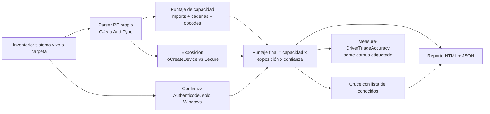

# DriverTriage

Puntúa drivers de kernel de Windows por **capacidades peligrosas** (mapeo de memoria física, terminación
arbitraria de procesos, acceso a MSR/puertos de E/S, cadena `\Device\PhysicalMemory`) para priorizar
candidatos **BYOVD desconocidos** — los que aún no están en ninguna lista de bloqueo — en vez de depender
solo de hashes ya catalogados. Solo lectura. Solo defensivo. Sin código de explotación.

## Por qué

Las listas de bloqueo (Microsoft, LOLDrivers) son reactivas: cubren lo ya descubierto. Esta herramienta
prueba una hipótesis distinta — que la combinación de **capacidad + exposición + confianza** predice el
riesgo de un driver incluso si nunca ha sido reportado — y la **evalúa con métricas**, no con intuición.
Ver [`docs/METHODOLOGY.md`](docs/METHODOLOGY.md) para el diseño completo, las limitaciones y el roadmap.

## Arquitectura



## Instalación y Guía de Uso Paso a Paso

> [!NOTE]
> **Asegúrate de situarte en la raíz del repositorio.** Si abres PowerShell con permisos de Administrador, la consola iniciará por defecto en `C:\WINDOWS\system32`. Debes navegar (`cd`) hasta la carpeta donde clonaste o descargaste el proyecto antes de ejecutar las rutas relativas.

### Paso 1. Clonar y posicionarse en el proyecto

```powershell
git clone https://github.com/DamianMacancela/DriverTriage.git
cd DriverTriage
```

*(Si descargaste el repositorio como ZIP, descomprímelo y ejecuta `Set-Location "C:\ruta\hacia\DriverTriage"`).*

---

### Paso 2. Importar el módulo en tu sesión

```powershell
Import-Module .\DriverTriage\DriverTriage.psd1 -Force
```

---

### Paso 3. Demo guiada con binarios sintéticos (100% seguro)

Para probar la herramienta **sin necesidad de interactuar con drivers reales ni poner en riesgo el sistema**, puedes usar el generador de ejecutables PE sintéticos incluido en el repositorio. Este script compila en memoria dos archivos `.sys` ficticios en bytes crudos: uno que replica las características de un driver vulnerable (*vulnerable-like*) y otro con imports estándar benignos (*benign-like*).

```powershell
# 1. Cargar el generador sintético
. .\tests\Helpers\New-SyntheticDriverPE.ps1

# 2. Construir fixture que simula un driver vulnerable tipo BYOVD
New-SyntheticDriverPE -Path .\tests\data\vulnerable-like.sys `
    -Imports @(@{Dll='ntoskrnl.exe';Functions=@('MmMapIoSpace','ZwTerminateProcess','IoCreateDevice','ZwOpenProcess')},@{Dll='hal.dll';Functions=@('READ_PORT_UCHAR')}) `
    -WideStrings @('\Device\PhysicalMemory') -OpcodeSequences @(,[byte[]](0x0F,0x32))

# 3. Construir fixture que simula un driver legítimo y benigno
New-SyntheticDriverPE -Path .\tests\data\benign-like.sys `
    -Imports @(@{Dll='ntoskrnl.exe';Functions=@('ZwCreateFile','ZwWriteFile','IoCreateDeviceSecure','IoCreateSymbolicLink')})

# 4. Ejecutar el escaneo de auditoría
$r = Invoke-DriverTriageScan -Path .\tests\data -OutputDirectory .\out -IncludeClean

# 5. Visualizar la tabla de resultados y abrir el reporte HTML
$r.Results | Format-Table FileName, Score, Severity
Start-Process .\out\report.html
```

---

### Paso 4. Escaneo sobre un sistema Windows real

Una vez validado el funcionamiento, puedes auditar entornos vivos:

```powershell
# Escanear los drivers actualmente cargados en memoria del sistema operativo:
Invoke-DriverTriageScan -UseSystemInventory -OutputDirectory .\out

# Escanear el almacén completo de drivers en disco de Windows:
Invoke-DriverTriageScan -Path C:\Windows\System32\drivers -OutputDirectory .\out

# Abrir el informe generado con sanitización anti-XSS:
Start-Process .\out\report.html
```

## Cómo se calcula el puntaje

```
puntaje = (Σ pesos de capacidad detectada) × multiplicador_exposición × multiplicador_confianza
```

| Señal | Ejemplo | Peso |
|---|---|---|
| Import `MmMapIoSpace` | Mapeo de memoria física arbitraria | 5 |
| Import `ZwTerminateProcess` | Terminación de proceso (abuso típico anti-EDR) | 4 |
| Cadena `\Device\PhysicalMemory` | Indicador clásico de BYOVD | 5 |
| Opcode `RDMSR`/`WRMSR` en sección ejecutable | Acceso a registros de modelo específico | 2 |
| Sección RWX (violación W^X) | Código ejecutable en sección modificable | 4 |
| Import `MmGetSystemRoutineAddress` | Mitigación contra evasión por resolución dinámica | 3 |
| Import `ZwLoadDriver` | Carga de controladores en espacio de kernel | 4 |
| `IoCreateDevice` sin `IoCreateDeviceSecure` | Dispositivo sin control de acceso declarado | ×1.5 |
| Sin firma o firma inválida | Reduce la confianza en el binario | ×1.3 |

Pesos y umbrales en [`DriverTriage/Data/capabilities.psd1`](DriverTriage/Data/capabilities.psd1) — son
hipótesis ajustables, no constantes fijas.

## Por qué el puntaje no es la última palabra

Cada hallazgo de severidad Alta o Crítica se cruza contra
[`DriverTriage/Data/known_vulnerable_sample.csv`](DriverTriage/Data/known_vulnerable_sample.csv) (una
**muestra de solo 2 entradas** — reemplázala por el feed completo de
[loldrivers.io](https://www.loldrivers.io/) antes de usar en producción). Una coincidencia por hash es
`Confirmed`; una coincidencia solo por nombre de archivo es `Heuristic` (puede ser una versión distinta o
un homónimo legítimo).

## Validación con métricas, no solo con intuición

```powershell
$r = Invoke-DriverTriageScan -Path .\tests\data -OutputDirectory .\out -IncludeClean
Measure-DriverTriageAccuracy -Result $r.Results -LabelsPath .\tests\data\labels.sample.json
```

Produce: matriz de confusión por umbral (precisión/recall/FPR), **recall@K**, y una **ablación por
categoría de capacidad** (qué señal aporta más a separar vulnerables de benignos). Ver
[`docs/METHODOLOGY.md`](docs/METHODOLOGY.md) para cómo construir un corpus etiquetado real.

## Límites éticos (obligatorios)

- Solo análisis estático y defensivo. **Cero código de explotación, cero PoC.**
- `tests/data/*.sys` son binarios **sintéticos** generados por
  [`tests/Helpers/New-SyntheticDriverPE.ps1`](tests/Helpers/New-SyntheticDriverPE.ps1), no drivers reales.
  El repo nunca distribuye binarios de terceros.
- Un hallazgo nuevo sobre software de terceros se reporta primero al fabricante (ver
  [`SECURITY.md`](SECURITY.md)), nunca se publica antes de coordinar.
- Pruebas solo en VMs/sistemas propios o con autorización.

## Limitaciones conocidas

| Limitación | Detalle |
|---|---|
| Resolución dinámica de APIs | Un driver que resuelve `MmMapIoSpace` en tiempo de ejecución evade la detección por import |
| Exposición por imports, no por flujo de control | `IoCreateDeviceSecure` no garantiza un SDDL restrictivo |
| Opcodes sin desensamblado real | Puede coincidir dentro de una instrucción más larga u operando |
| Firma válida ≠ benigno | Varios drivers vulnerables conocidos están firmados legítimamente |
| `Get-DriverTrust` requiere Windows | En Linux/macOS siempre devuelve `Unknown` (documentado, no oculto) |

Detalle completo en [`docs/METHODOLOGY.md`](docs/METHODOLOGY.md).

## Desarrollo

```powershell
Invoke-Pester .\tests -CI
Invoke-ScriptAnalyzer .\DriverTriage -Recurse
```

El parser de PE es C# puro compilado vía `Add-Type` (`DriverTriage/Private/PEParser.cs`): lee bytes de
archivo directamente, sin mapear el binario en memoria ni ejecutar nada.

## Despliegue Seguro y Hardening (AppSec)

Para despliegues en entornos de producción o multiusuario:
- **Ruta de instalación administrativa:** Se recomienda instalar o ubicar el módulo en directorios protegidos por el sistema (`$env:ProgramFiles\PowerShell\Modules` o `$env:ProgramFiles\WindowsPowerShell\Modules`), donde las listas de control de acceso (ACLs) exigen privilegios de Administrador para escritura, evitando vectores de DLL hijacking o manipulación maliciosa de scripts por usuarios no privilegiados.
- **Principio de menor privilegio:** DriverTriage opera en modo de **estricta solo lectura**. No requiere permisos de escritura en el registro ni en las carpetas de drivers del sistema analizado (únicamente requiere escritura sobre la ruta de salida especificada en `-OutputDirectory`).

## Roadmap

Desensamblado real para opcodes y rastreo de IOCTL (Capstone/Ghidra) · detección de resolución dinámica de
APIs · generación de política WDAC en modo auditoría (borrador en `scripts/New-WdacAuditPolicy.ps1`) ·
curva ROC/AUC y calibración formal de pesos con un corpus mayor.

## Uso autorizado

Defensa únicamente. Ver [`SECURITY.md`](SECURITY.md).

## Licencia

MIT
